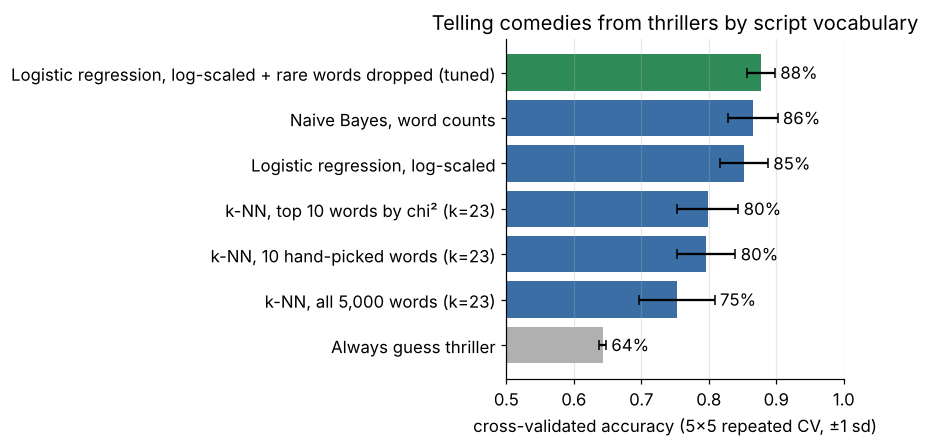
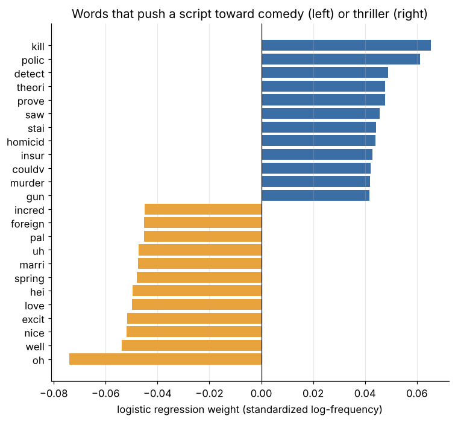

# Comedy or Thriller? Classifying Movies by Script Vocabulary

Can you tell a movie's genre just from the words in its screenplay, without plot, actors or tone? This project compares several classifiers on 333 movie scripts and gets to **88% cross-validated accuracy** with an interpretable logistic regression. Inspecting what the model learned turned out to be what improved it the most.



## Results

| Approach | Accuracy (5×5 repeated CV) |
|---|---|
| Always guess "thriller" (baseline) | 64% |
| k-NN, all 5,000 words | 75% |
| k-NN, 10 hand-picked words (k chosen by CV) | 80% |
| k-NN, top 10 words chosen by chi-squared | 80% |
| Logistic regression, log-scaled frequencies | 85% |
| Naive Bayes, word counts | 86% |
| **Logistic regression, log-scaled + rare words dropped (nested-CV tuned)** | **88% ± 2%** |

On the original fixed 50-movie test set, the final model scores 82%, compared with 78% for k-NN on hand-picked words.

## What I found

**1. More features made k-NN worse.** Going from 10 hand-picked words to all 5,000 dropped accuracy from 80% to 75%. In 5,000 dimensions, Euclidean distance is dominated by irrelevant words, and that's the curse of dimensionality. Selecting words automatically with a chi-squared test (inside each fold, so nothing leaks) matched hand-picking. k-NN still collapsed to the baseline once it had a few hundred words.

**2. The first logistic regression was memorizing character names.** Its strongest "comedy" signals included `gruner` and `bastaldi`, names that each appear in exactly one script. Dropping words used in less than 10% of training scripts removed them and raised accuracy from 85% to 88%. The cutoff was tuned by nested cross-validation, not hand-picked.

**3. Comedies are recognized by how people talk.** After that fix, the top comedy words are conversational: *oh, well, nice, uh, hey, excited, love*. Thriller words are about crime and investigation: *kill, police, detective, theory, prove, homicide, murder, gun*.



**4. The errors are genre-blends.** The most confident mistakes are comedies set in thriller territory: *The Sting* (con artists), *Dr. Strangelove* (nuclear war), *Star Trek IV* and *Innerspace* (sci-fi), *Slither* (horror-comedy). Their scripts use thriller vocabulary played for laughs, and word counts can't see tone. With balanced class weights, the final model catches 81% of comedies and 92% of thrillers.

## Methods

- **Data:** 333 screenplays (214 thrillers, 119 comedies). Each one is represented as the share of the script taken up by each of ~5,000 stemmed words.
- **Evaluation:** 5-fold stratified cross-validation repeated 5 times (25 fits per model). Hyperparameters (k, number of words, regularization strength `C`, rare-word cutoff) are tuned in an inner CV loop (nested CV), so reported scores never use data that helped tune the model.
- **Final model:** a scikit-learn pipeline that drops words used in under 10% of scripts, applies log(1 + 1000·frequency), standardizes, then fits L2-regularized logistic regression (`C = 0.01`, balanced class weights) on the 1,848 words that remain.

## Run it

```bash
pip install -r requirements.txt
# place movies.csv in data/ (see data/README.md)
jupyter notebook notebook.ipynb
```


## Next steps

- Sentence-embedding features, which capture meaning rather than word counts and might pick up tone
- More than two genres
- TF-IDF weighting to downweight words every script uses

## Tools

Python, pandas, NumPy, scikit-learn, Matplotlib

---
*The dataset comes from UC Berkeley's Data 8 course. This project extends the course's k-NN assignment with model comparison, nested cross-validation, feature selection and error analysis.*
